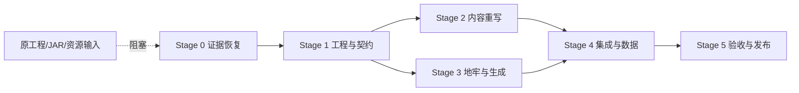

# Aether Bedrock Mobs Reborn — 总任务表

> 来源：[重写设计文档](./aether-bedrock-mobs-reborn-design.md)。范围：Minecraft 1.20.1 Forge 的功能等价重写。复杂度仅表示工作量级别，不表示时间。
>
> 状态：☐ 待开始 · ◐ 进行中 · ☑ 完成 · ⛔ 阻塞。复杂度：S / M / L。

## 里程碑

| 里程碑 | 可验证交付物 | 阶段 |
|---|---|---|
| M0 | 输入证据、功能清单、注册 ID、依赖和授权记录齐全 | Stage 0 |
| M1 | 干净的 1.20.1 Forge 工程与冻结的重写契约 | Stage 1 |
| M2 | 实体、Boss、物品、装备、模型和动画完成 | Stage 2 |
| M3 | 地牢、结构、生成规则和维度限制完成 | Stage 3 |
| M4 | Aether 接入、数据包、配置、语言和服务端加载完成 | Stage 4 |
| M5 | 构建、静态检查、运行验收和发布材料完成 | Stage 5 |

## Stage 0 · 证据恢复 → M0

| ID | 任务 | 复杂度 | 依赖 | 验收标准 | 文件/产物 |
|---|---|---:|---|---|---|
| ☑ T0.1 | 获取并登记原始 MCreator 工程、正式 JAR、资源包或截图 | L | — | 已取得正式 JAR，记录来源、版本和哈希；原始工程仍缺失 | `evidence/` |
| ◐ T0.2 | 盘点实体、Boss、物品、装备、结构、方块和生成规则 | L | T0.1 | 已完成注册 ID、资源数量、属性、掉落和世界生成初盘；Boss 阶段和结构内部连接仍需逐项复核 | `docs/evidence-inventory.md` |
| ☑ T0.3 | 核对 Aether、GeckoLib、Forge 版本及授权边界 | M | T0.1 | Forge 47.4.23、Aether CurseMaven 文件 6134920、GeckoLib 4.8.4 已冻结；资源来源审计仍保留为发布前任务 | `docs/dependency-matrix.md` |
| ☑ T0.4 | 冻结首版模组 ID、包结构、注册命名和兼容范围 | M | T0.2, T0.3 | 已冻结 `aether_bedrock_mobs_reborn`、`com.aetherbedrockmobsreborn`；默认不承诺旧存档兼容 | `docs/aether-bedrock-mobs-reborn-design.md` |

## Stage 1 · 工程与契约 → M1

| ID | 任务 | 复杂度 | 依赖 | 验收标准 | 文件/产物 |
|---|---|---:|---|---|---|
| ☑ T1.1 | 从匹配模板创建 1.20.1 Forge 工程 | M | T0.4 | 基于 `E:\模组\模组模板\1201-forge` 创建；`gradlew build` 通过 | `build.gradle`, `settings.gradle`, `src/` |
| ◐ T1.2 | 建立注册表、包结构、数据生成和生命周期骨架 | M | T1.1 | 注册、客户端渲染、GeckoLib、Boss 条、第一阶段死亡转阶段二和特殊召唤方块已接入；Boss 攻击与实体专属行为仍待重写 | `src/main/java/` |
| ☑ T1.3 | 建立资源、语言、数据命名规范和内容清单映射 | M | T0.2, T1.1 | 原资源已迁移到新命名空间，已补 `zh_cn.json`、38 个声音事件、3 个粒子类型并通过 JSON 静态检查 | `src/main/resources/` |

## Stage 2 · 内容重写 → M2

| ID | 任务 | 复杂度 | 依赖 | 验收标准 | 文件/产物 |
|---|---|---:|---|---|---|
| ◐ T2.1 | 重写普通实体、属性、AI、掉落和生成条件 | L | T1.2, T1.3 | 当前 27 个实体类型可注册；Dragon 二阶段并入 `aetherdragon`，属性、基础 AI、飞行移动、掉落和生物群系修饰器已接入，实体专属攻击仍待补齐 | `entity/`, `registry/` |
| ◐ T2.2 | 重写 Boss、召唤条件、阶段行为和 Boss 战奖励 | L | T1.2, T1.3 | Boss 条、召唤方块、夜间限制、艾瑟龙阶段转换和基础掉落已接入；Boss 攻击模式与完整奖励仍待单独核验 | `entity/`, `data/loot/` |
| ◐ T2.3 | 重写武器、工具、装备和特殊物品 | M | T1.2, T1.3 | 14 个普通物品/装备和 13 个配方已注册或迁移；武器、护甲属性、冷却、主动效果和投射物已接入，仍需运行验收 | `registry/`, `data/recipes/` |
| ◐ T2.4 | 重建 GeckoLib 模型、动画控制器和客户端渲染器 | L | T2.1, T2.2 | 已接入 10 组 Geo 模型/动画映射和客户端渲染；Elder、Salt King、Spirit 仍使用临时通用渲染器 | `client/`, `assets/` |

## Stage 3 · 地牢与世界生成 → M3

| ID | 任务 | 复杂度 | 依赖 | 验收标准 | 文件/产物 |
|---|---|---:|---|---|---|
| ◐ T3.1 | 重建 Crystalite、Labyrinth、Spirit、Salt、Elder 等结构 | L | T0.2, T1.3 | 6 个结构 NBT、结构定义、结构集合和模板池已迁移；仍需专用服务端加载核验 | `data/structures/` |
| ☐ T3.2 | 接入 Aether 维度中的结构放置和生成规则 | L | T3.1, T1.2 | 结构只在目标维度/生物群系条件下生成 | `worldgen/`, `data/` |
| ☐ T3.3 | 实现“其他扩展生物群系不生成”或确认其真实规则 | M | T0.2, T3.2 | 规则有来源；数据加载和边界条件检查通过 | `worldgen/`, `event/` |

## Stage 4 · 集成与数据 → M4

| ID | 任务 | 复杂度 | 依赖 | 验收标准 | 文件/产物 |
|---|---|---:|---|---|---|
| ◐ T4.1 | 补齐战利品、配方、标签、进度和语言文件 | M | T2.3, T3.1 | 方块战利品、13 个配方、6 个进度、标签和中英文语言键已迁移；实体专属战利品仍有代码侧待完善项 | `data/`, `src/main/resources/assets/aether_bedrock_mobs_reborn/lang/` |
| ☐ T4.2 | 接入 Aether 生命周期、事件和服务端状态同步 | L | T2.1, T2.2, T3.2 | 专用服务端可加载；客户端与服务端状态契约一致 | `event/`, `network/`, `common/` |
| ☐ T4.3 | 处理配置、默认值和必要的数据迁移说明 | M | T0.4, T4.2 | 配置可生成；兼容范围和不兼容项写入文档 | `config/`, `docs/` |

## Stage 5 · 验收与发布 → M5

| ID | 任务 | 复杂度 | 依赖 | 验收标准 | 文件/产物 |
|---|---|---:|---|---|---|
| ◐ T5.1 | 运行静态检查、资源检查和 `gradlew build` | M | T4.1, T4.2 | `gradlew build`、351 个 JSON 解析、旧命名空间和 Java 注释检查均通过；尚未完成客户端/服务端运行验收 | `build/libs/`、构建日志 |
| ☐ T5.2 | 按测试矩阵验证启动、维度、结构、实体、Boss、掉落和正常退出 | L | T5.1 | 每项记录通过/失败、版本、日志和复现条件；客户端运行需单独授权 | `docs/test-matrix.md` |
| ☐ T5.3 | 审核正式 JAR、元数据、依赖、许可证和变更日志 | M | T5.1, T5.2 | 只保留正式产物；发布信息与实际兼容范围一致 | `release/`、发布清单 |

## 依赖图

关键路径：`T0.1 → T0.2/T0.3 → T0.4 → T1.1/T1.2 → T2.1/T2.2 与 T3.1/T3.2 → T4.2 → T5.1 → T5.2/T5.3`。当前已通过 T0.4、T1.1、T1.3；T1.2、T2.1–T2.4、T3.1 和 T4.1 正在推进。

## 阻塞研究与待确认项

| ID | 项目 | 阻塞任务 | 解决方式 |
|---|---|---|---|
| ⛔ R1 | 原始 MCreator 工程、JAR 或资源是否可取得 | T0.1–T0.4 | 用户提供输入；对 JAR 做只读内容盘点 |
| ⛔ R2 | Aether 与 GeckoLib 确切版本 | T0.3, T1.1 | 查原工程、目标整合包和缓存 JAR |
| ⛔ R3 | 结构文件与真实生成规则 | T0.2, T3.1–T3.3 | 查工程/数据包/JAR；必要时单独标记无法复原 |
| ⛔ R4 | 是否要旧存档/注册 ID 兼容 | T0.4, T4.3 | 用户确认；默认不承诺 |

## 风险登记

| 风险 | 等级 | 缓解 | 关联任务 |
|---|---|---|---|
| 输入缺失导致内容无法等价复原 | 高 | 将证据恢复设为硬门禁 | T0.1–T0.4 |
| MCreator 生成代码不可维护 | 高 | 只按功能和资源重写 | 全部 Stage 2 |
| 目标依赖 API 漂移 | 高 | 先看依赖源码/JAR，再冻结版本 | T0.3, T1.1, T4.2 |
| 世界生成问题只在运行时出现 | 中 | 数据加载、专用服务端和客户端分层验收 | T3.2, T5.2 |

## 完成定义

- ☐ M0–M5 每个里程碑都有可核验产物。
- ☐ 清单内功能没有无记录的删减；无法确认的内容已显式列出。
- ☐ 1.20.1 Forge 工程通过静态检查和 `gradlew build`。
- ☐ 客户端启动、维度进入、结构生成、实体战斗、掉落和正常退出有独立记录。
- ☐ 正式 JAR、依赖、许可证、版本元数据和变更日志互相一致。

