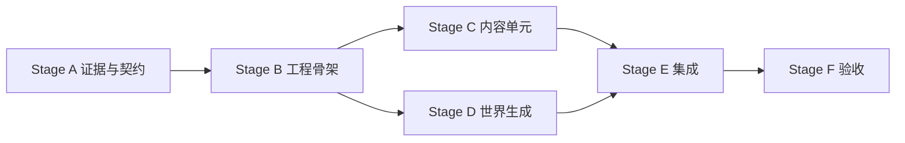

# Aether Bedrock Mobs Reborn — 并行任务表

> 来源：[重写设计文档](./aether-bedrock-mobs-reborn-design.md) 与 [总任务表](./aether-bedrock-mobs-reborn-master-task-plan.md)。
>
> 规则：同一阶段的任务不能共享写入文件，也不能互相依赖；阶段之间通过门禁串行推进。

## 0. 使用规则

1. 只有前置阶段全部完成后，才能领取该阶段任务。
2. 任务开始时将 `☐` 改为 `◐` 并填写负责人；完成后改为 `☑` 并记录产物。
3. 只修改任务的 `Owns` 路径；`Reads` 路径只读。
4. 需要修改冻结契约或其他任务文件时，先登记变更请求，不直接覆盖。
5. 每个阶段全部完成后先执行该阶段门禁，再开放下一阶段。

## 1. 进度回写协议

每项任务完成后，按行更新：

- 本文档对应任务的状态和输出；
- 总任务表对应的 `T*` 状态；
- 只有在待确认事项解决或设计改变时，才更新设计文档。

## 2. 冻结约定

- 目标：Minecraft 1.20.1 Forge。
- 模组显示名：Aether Bedrock Mobs Reborn。
- 模组 ID：冻结为 `aether_bedrock_mobs_reborn`。
- 原 MCreator Java：不作为迁移基础，不复制其类层级。
- 资源命名空间：与冻结后的模组 ID 一致。
- Aether、GeckoLib、Forge 的具体版本已冻结为 Aether 文件 6134920、GeckoLib 4.8.4、Forge 47.4.23。
- 可选依赖不写入必需依赖声明。
- 玩家可见文本使用语言键，同时维护 `zh_cn.json` 与 `en_us.json`。

## 3. 阶段与依赖

| 阶段 | 并行任务 | 前置 | 里程碑 |
|---|---|---|---|
| A | PA-1、PA-2、PA-3 | 无；但需要原始输入 | M0 |
| B | PB-1、PB-2 | A 完成 | M1 |
| C | PC-1、PC-2、PC-3 | B 完成 | M2 |
| D | PD-1、PD-2 | B 完成，读取结构证据 | M3 |
| E | PE-1、PE-2 | C、D 完成 | M4 |
| F | PF-1、PF-2 | E 完成 | M5 |

## 4. 任务详情

### Stage A · 证据与契约（前置：原始工程/JAR/资源输入）

**PA-1 · 原始输入盘点**  ☑ 负责人：主代理 产物：`evidence/source-index.md`、`evidence/hashes.txt`

- Owns：`evidence/source-index.md`、`evidence/hashes.txt`
- Reads：用户提供的 MCreator 工程、正式 JAR、资源包和截图
- 交付/验收：记录来源、版本、哈希、文件类型和可读取范围；不修改输入
- 对应：T0.1

**PA-2 · 内容与行为清单**  ◐ 负责人：主代理 产物：`docs/evidence-inventory.md`

- Owns：`docs/evidence-inventory.md`
- Reads：`evidence/`、原页面描述
- 交付/验收：实体、Boss、物品、装备、结构、生成规则和动画均有来源状态
- 对应：T0.2

**PA-3 · 依赖、授权与兼容契约**  ☑ 负责人：主代理 产物：`docs/dependency-matrix.md`

- Owns：`docs/dependency-matrix.md`、设计文档契约段
- Reads：输入证据、目标模板、缓存依赖 JAR
- 交付/验收：Forge/Aether/GeckoLib 版本、许可证、模组 ID 和兼容范围已冻结或显式标记
- 对应：T0.3、T0.4

> Gate A：输入证据可复核；功能清单、依赖矩阵和注册命名契约完成，未知项不能被隐藏。

### Stage B · 工程骨架（前置：Stage A）

**PB-1 · Forge 工程与入口**  ☑ 负责人：主代理 产物：`build.gradle`、`gradle.properties`、`src/main/java/com/aetherbedrockmobsreborn/AetherBedrockMobsReborn.java`

- Owns：`build.gradle`、`settings.gradle`、`gradle.properties`、`src/main/java/com/aetherbedrockmobsreborn/AetherBedrockMobsReborn.java`
- Reads：设计契约、目标模板
- 交付/验收：1.20.1 Forge 工程可配置；空骨架 `build` 通过
- 对应：T1.1

**PB-2 · 注册与资源骨架**  ◐ 负责人：主代理 产物：`src/main/java/com/aetherbedrockmobsreborn/`、`src/main/resources/assets/aether_bedrock_mobs_reborn/`

- Owns：`src/main/java/com/aetherbedrockmobsreborn/registry/`、`src/main/resources/META-INF/`、`src/main/resources/assets/aether_bedrock_mobs_reborn/lang/`
- Reads：冻结 ID、内容清单
- 交付/验收：注册入口、资源命名空间、声音/粒子注册和中英文语言文件一致；`gradlew build` 通过
- 对应：T1.2、T1.3

> Gate B：完整工程骨架编译通过；注册、命名空间、语言和依赖契约不再随意变更。

### Stage C · 内容单元（前置：Stage B）

**PC-1 · 普通实体**  ☐ 负责人：___ 产物：___

- Owns：`src/main/java/com/aetherbedrockmobsreborn/entity/ambient/`、对应实体数据和掉落文件
- Reads：注册契约、行为清单、服务端状态约定
- 交付/验收：普通实体的属性、AI、掉落和生成条件完成；无客户端类依赖
- 对应：T2.1

**PC-2 · Boss 与特殊物品**  ◐ 负责人：主代理 产物：`src/main/java/com/aetherbedrockmobsreborn/block/SpecialSpawnerBlock.java`、`src/main/java/com/aetherbedrockmobsreborn/item/`、`src/main/java/com/aetherbedrockmobsreborn/entity/RebornProjectileEntity.java`

- Owns：`src/main/java/com/aetherbedrockmobsreborn/entity/boss/`、`src/main/java/com/aetherbedrockmobsreborn/item/`、对应战利品和配方
- Reads：注册契约、Boss 行为清单、状态字段约定
- 交付/验收：召唤、阶段转换、基础掉落和主要物品效果已接入；Boss 专属攻击、奖励和运行测试仍待完成
- 对应：T2.2、T2.3

**PC-3 · 模型、动画与渲染**  ◐ 负责人：主代理 产物：`src/main/java/com/aetherbedrockmobsreborn/client/`、`src/main/resources/assets/aether_bedrock_mobs_reborn/`

- Owns：`src/main/java/com/aetherbedrockmobsreborn/client/`、`src/main/resources/assets/aether_bedrock_mobs_reborn/geo/`、`textures/`、`animations/`
- Reads：实体 ID、动画证据、客户端状态契约
- 交付/验收：10 组 Geo 模型/动画映射和客户端渲染已接入；3 个非 Geo Boss 仍使用临时通用渲染器
- 对应：T2.4

> Gate C：内容单元编译通过，资源文件和注册 ID 一一对应；不把集成接线塞回内容单元。

### Stage D · 地牢与世界生成（前置：Stage B）

**PD-1 · 结构文件与地牢数据**  ☐ 负责人：___ 产物：___

- Owns：`src/main/resources/data/aether_bedrock_mobs_reborn/structures/`、结构相关标签和模板数据
- Reads：结构证据、注册契约
- 交付/验收：每个有证据的地牢可加载；缺失结构单列而不伪造
- 对应：T3.1

**PD-2 · 放置、生成与维度规则**  ☐ 负责人：___ 产物：___

- Owns：`src/main/java/com/aetherbedrockmobsreborn/worldgen/`、`src/main/resources/data/aether_bedrock_mobs_reborn/worldgen/`、生成事件文件
- Reads：结构文件、Aether API 证据、维度和生物群系规则
- 交付/验收：结构和实体只在目标条件下生成；排除规则有来源
- 对应：T3.2、T3.3

> Gate D：数据加载和结构文件检查通过；生成入口集中，内容单元不直接改写世界生成注册。

### Stage E · 集成与数据（前置：Stage C、D）

**PE-1 · 数据包与本地化**  ☐ 负责人：___ 产物：___

- Owns：`src/main/resources/data/` 中的战利品、配方、标签、进度和 `src/main/resources/assets/aether_bedrock_mobs_reborn/lang/`
- Reads：实体、物品、结构 ID
- 交付/验收：中英文语言键齐全；数据包加载无错误
- 对应：T4.1

**PE-2 · 生命周期、事件、同步与配置**  ☐ 负责人：___ 产物：___

- Owns：`src/main/java/com/aetherbedrockmobsreborn/event/`、`network/`、`config/`、`common/`
- Reads：所有已完成内容和冻结状态契约
- 交付/验收：Aether 生命周期接入、服务端状态同步和配置完成；不引入未记录的功能删改
- 对应：T4.2、T4.3

> Gate E：专用服务端数据加载通过；客户端与服务端使用同一注册和状态契约。

### Stage F · 验收与发布（前置：Stage E）

**PF-1 · 构建与静态检查**  ◐ 负责人：主代理 产物：`docs/build-verification.md`、`build/libs/aether_bedrock_mobs_reborn-0.1.0.jar`

- Owns：`docs/build-verification.md`、构建输出记录
- Reads：全部源码和资源
- 交付/验收：`gradlew build`、351 个 JSON 解析、旧命名空间和 Java 注释检查均通过；客户端/服务端运行验收仍待完成
- 对应：T5.1

**PF-2 · 运行验收与发布审计**  ☐ 负责人：___ 产物：___

- Owns：`docs/test-matrix.md`、`docs/release-checklist.md`、`release/`
- Reads：正式 JAR、构建记录、许可证和依赖矩阵
- 交付/验收：启动、维度、结构、实体、Boss、掉落和正常退出逐项记录；正式 JAR 元数据一致
- 对应：T5.2、T5.3

> Gate F：构建、运行、发布三类证据分开保存；未做客户端游玩测试的项目不能标记为玩法完成。

## 5. 研究结果写回区

- 当前目标目录为空，未发现可直接迁移的 MCreator 工程或 Git 历史；已取得公开正式 JAR，作为只读证据保存在 `D:\AI临时文件`。
- PA-1 已完成；PA-2、PA-3 已有初步结果，但实体行为、目标依赖版本和资源授权仍待复核，Stage A 暂不放行。

## 6. 文件所有权矩阵

| 文件/目录 | 所属任务 | 阶段 |
|---|---|---|
| `evidence/` | PA-1 | A |
| `docs/evidence-inventory.md` | PA-2 | A |
| `docs/dependency-matrix.md` | PA-3 | A |
| `build.gradle`、`settings.gradle`、`gradle.properties` | PB-1 | B |
| `src/main/java/com/aetherbedrockmobsreborn/AetherBedrockMobsReborn.java` | PB-1 | B |
| `src/main/java/com/aetherbedrockmobsreborn/registry/` | PB-2 | B |
| `src/main/resources/META-INF/` | PB-2 | B |
| `src/main/resources/assets/aether_bedrock_mobs_reborn/lang/` | PB-2※ → PE-1 | B → E |
| `src/main/java/com/aetherbedrockmobsreborn/entity/ambient/` | PC-1 | C |
| `src/main/java/com/aetherbedrockmobsreborn/entity/boss/` | PC-2 | C |
| `src/main/java/com/aetherbedrockmobsreborn/item/` | PC-2 | C |
| `src/main/java/com/aetherbedrockmobsreborn/client/` | PC-3 | C |
| `src/main/resources/assets/aether_bedrock_mobs_reborn/geo/`、`textures/`、`animations/` | PC-3 | C |
| `src/main/resources/data/aether_bedrock_mobs_reborn/structures/` | PD-1 | D |
| `src/main/java/com/aetherbedrockmobsreborn/worldgen/` | PD-2 | D |
| `src/main/resources/data/aether_bedrock_mobs_reborn/worldgen/` | PD-2 | D |
| `src/main/resources/data/` 数据子目录 | PE-1 | E |
| `src/main/java/com/aetherbedrockmobsreborn/event/`、`network/`、`common/` | PE-2 | E |
| `docs/build-verification.md` | PF-1 | F |
| `docs/test-matrix.md`、`docs/release-checklist.md`、`release/` | PF-2 | F |

※ 表示跨阶段串行交接，不允许同阶段并行写入。

## 7. 变更请求记录

| 编号 | 日期 | 提出者 | 变更 | 处理 |
|---|---|---|---|---|
| — | — | — | — | — |

## 8. 并行任务与里程碑映射

| 并行任务 | 总任务 ID | 里程碑 |
|---|---|---|
| PA-1、PA-2、PA-3 | T0.1–T0.4 | M0 |
| PB-1、PB-2 | T1.1–T1.3 | M1 |
| PC-1、PC-2、PC-3 | T2.1–T2.4 | M2 |
| PD-1、PD-2 | T3.1–T3.3 | M3 |
| PE-1、PE-2 | T4.1–T4.3 | M4 |
| PF-1、PF-2 | T5.1–T5.3 | M5 |

